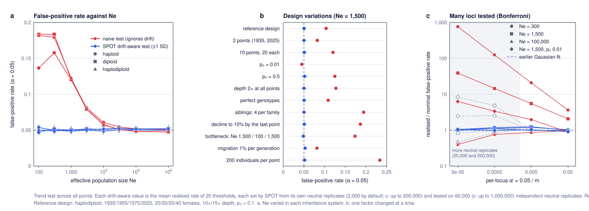

# False-positive rate: drift-aware against naive test

The question: when no selection acts, how often does each test declare selection? A well-calibrated test at α = 0.05 should do so in 5% of neutral loci.



## Methods

- **Drift-aware test (SPOT).** For each design, SPOT set its threshold exactly as on the page, from its own neutral replicates (default 1,000 replicates under selection and 2,000 neutral). This was repeated with 20 different random seeds, giving 20 thresholds.
- **Realised false-positive rate.** Each threshold was applied to a large, **independent** set of neutral replicates: 60,000 in panels a and b; in panel c, 120,000 for m = 1 and 10 and 1,000,000 for m = 100 and 1,000. The share of them above the threshold is that threshold's realised false-positive rate. Using independent replicates matters: on the replicates that set the threshold, the rate is 5% by construction.
- **Naive test.** Uses the textbook threshold z₁₋α′ on the same independent replicates. It treats sampling noise as the only source of variation, which is what a standard test of allele-frequency change does.
- **Reference design.** Haplodiploid; sampling in 1935, 1955, 1975 and 2025 (90 generations); 20, 20, 20 and 40 females; 10× depth at the earlier points and 15× at the last; p₀ = 0.1.
- **a. Effective size.** Ne from 100 to 1,000,000 in each inheritance system (haploid, diploid, haplodiploid).
- **b. Design factors.** With Ne = 1,500 (1,000 breeding females and 1,000 males), one design factor changed at a time.
- **c. Many loci.** Several candidate loci with a Bonferroni correction: α′ = 0.05/m for m = 1, 10, 100 and 1,000 (see below).

## Results

- **The drift-aware test holds its nominal level, the naive test does not.**
  - Trend test, all 36 designs of panels a and b: SPOT's mean realised false-positive rate was 4.5–5.4% (mean 5.1%).
  - Naive test, same designs: up to 23%.
  - Inflation of the naive test is largest when drift is strong relative to sampling noise: small Ne, large samples, related individuals or a decline in population size (all designs here span 90 generations; more generations also mean more drift). With Ne = 100–300 the naive test rejected 14–18% of neutral loci.
  - At Ne ≥ 30,000 both tests were close to 5%, as expected when drift is negligible over 90 generations.
- **Larger samples make the naive test worse, not better.** With 200 individuals per point instead of 20–40, the naive false-positive rate rose to 23%: sampling noise shrinks, so drift makes up a larger part of the change. The drift-aware test stayed at 5.1%.
- **Every design factor tested was handled:**
  - 2 or 10 sampling points
  - p₀ = 0.01 or 0.5
  - 2× depth or perfect genotypes
  - siblings in the sample
  - population decline
  - a bottleneck between dates
  - migration

  The drift-aware rate stayed within 4.5–5.3%, while the naive rate ranged from 4.5% to 19%.
- **Rare alleles.** With p₀ = 0.01, many samples contain no copy of the allele and the statistic takes few values. The drift-aware test is then slightly conservative (4.3–4.5%). The naive test was not reliable either way: 4.5% with the trend test and 1.7% with the two-point test.
- **Precision of the threshold.** One SPOT run uses one threshold. Across the 20 thresholds the realised rate varied with a standard deviation of 0.3–0.65 percentage points for the trend test, and 0.35–1.1 for the two-point test (largest for haploids with large Ne and for p₀ = 0.01, where the statistic is most discrete). This matches the binomial expectation for a 95% quantile estimated from 2,000 neutral replicates, √(0.05 × 0.95 / 2,000) ≈ 0.5 points. With the default settings, a single run's threshold therefore gives a false-positive rate of about 5% ± 1%.
- **Two-point test.** Same pattern: mean 4.85%, range 3.7–5.2%. It is conservative for haploids with large Ne (3.7–4.3%), where the statistic is more discrete (one allele per individual, and only two sampling points).

## Many candidate loci

With m candidate loci and a Bonferroni correction, each locus is tested at α′ = 0.05/m. An empirical quantile needs about 10 neutral replicates beyond the threshold, so SPOT simulates 10/α′ neutral replicates when this exceeds the default 2,000 (20,000 for m = 100, 200,000 for m = 1,000; maximum 200,000). An earlier version fitted a Gaussian distribution to the 2,000 neutral replicates instead; panel c shows both.

| α′ (m) | Neutral replicates | Drift-aware, realised / nominal | Earlier Gaussian fit | Naive test |
|---|---|---|---|---|
| 0.05 (1) | 2,000 | 0.9–1.0 | (same) | 0.9–3.6 |
| 0.005 (10) | 2,000 | 1.0–1.25 | (same) | 0.9–21 |
| 0.0005 (100) | 20,000 | 1.0–1.2 | 0.8–4.8 | 0.8–125 |
| 0.00005 (1,000) | 200,000 | 1.0–1.05 | 0.5–8.3 | 0.4–760 |

(Trend test, four designs: Ne = 300, 1,500 and 100,000 with p₀ = 0.1, and Ne = 1,500 with p₀ = 0.01. With the two-point test the drift-aware ratios were 0.67–1.08.)

- **The Gaussian fit was not calibrated.** With strong drift (Ne = 300) it gave about 2.4–2.7 times the nominal rate, and with a rare allele (p₀ = 0.01) about 5–9 times (both sets of runs, `fpr_C_gaussian.tsv` and `small_alpha.tsv`): the neutral distribution of the statistic has a heavier upper tail than a Gaussian with the same mean and SD. With the two-point test it was very conservative.
- **More neutral replicates fix it.** With the empirical quantile from 10/α′ neutral replicates, the realised rate was 0.98–1.19 times nominal for the trend test in all designs. The small excess comes from estimating a quantile from about 10 exceedances. `small_alpha_thresholds.js` also showed that an exponential tail fitted to the upper 5% of the neutral values is far too conservative.
- **Cost.** About 0.05 ms per neutral replicate for the reference design: 200,000 take about 10–30 seconds in the browser. The page runs such cases in the background and says so under the number of loci. Beyond 200,000 (α′ < 0.00005, for example m > 1,000 at α = 0.05) the Gaussian fit is still used and the page marks the result as approximate. To stay fast, the power curve, planner and sampling comparison use at most 20,000 neutral replicates per setting.

## Files and how to reproduce

| File | Content |
|---|---|
| `false_positive_rate.js` | Simulations for panels a, b and c (`A`, `B`, `C` as argument); writes `fpr_A.tsv`, `fpr_B.tsv`, `fpr_C.tsv`. |
| `small_alpha_thresholds.js` | Alternatives to the Gaussian fit for small α′; writes `small_alpha.tsv`. |
| `fpr_C_gaussian.tsv` | Panel c with the earlier Gaussian-fit rule (SPOT before version 0.9.1), kept for comparison. |
| `fpr_figure.py` | Draws `false_positive_rate.svg` (Python standard library only, with `svgplot.py`). |

```
node validation/false_positive_rate.js A > validation/fpr_A.tsv     # about 3 minutes
node validation/false_positive_rate.js B > validation/fpr_B.tsv     # about 2 minutes
node validation/false_positive_rate.js C > validation/fpr_C.tsv     # about 25 minutes (or C 0,1 and C 2,3 in parallel)
node validation/small_alpha_thresholds.js > validation/small_alpha.tsv   # about 10 minutes
python3 validation/fpr_figure.py
```
