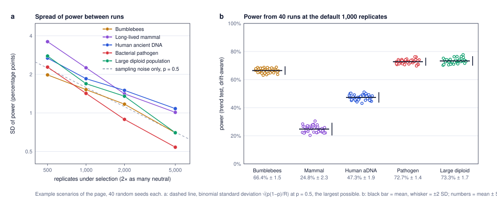

# Monte Carlo precision

Power in SPOT is a Monte Carlo estimate, so two runs with different random seeds give slightly different values. This analysis measures how much, for the example scenarios of the page.



## Methods

- **Scenarios:** the five biological example scenarios of the page (bumblebees, long-lived mammal, human ancient DNA, bacterial pathogen, large diploid population), with their default values. The sixth, the analytic baseline without drift, was left out.
- **Runs:** each was run with 40 random seeds at 500, 1,000 (the default), 2,000 and 5,000 replicates under selection, each time with twice as many neutral replicates.
- **Measures:** the standard deviation (SD) of the power estimate across seeds, compared with the SD expected from the sampling of selection replicates alone, √(p(1 − p)/R).

## Results

Trend test across all points, drift-aware threshold:

| Scenario | Mean power | SD at 500 | SD at 1,000 (default) | SD at 2,000 | SD at 5,000 |
|---|---|---|---|---|---|
| Bumblebees | 66% | 2.0 | 1.5 | 1.2 | 0.7 |
| Long-lived mammal | 25% | 3.6 | 2.3 | 1.4 | 1.0 |
| Human ancient DNA | 47% | 2.7 | 1.9 | 1.5 | 1.1 |
| Bacterial pathogen | 73% | 2.3 | 1.4 | 0.9 | 0.5 |
| Large diploid population | 73% | 2.8 | 1.7 | 1.4 | 0.7 |

(SD in percentage points, from 40 seeds; each SD has a relative standard error of about 11%.)

- **Default settings.** With 1,000 replicates under selection, the power of one run is within about ±3 to ±4.5 percentage points of the value an infinite number of replicates would give (±2 SD, SD 1.4–2.3 points).
- **More replicates.** The SD falls roughly as 1/√R: about 1 point or less at 5,000 replicates.
- **Two sources of noise.** The SD was up to 1.9 times the value expected from sampling the selection replicates alone, because the drift-aware threshold is itself estimated from neutral replicates. For the bumblebees and the pathogen the ratio was 0.9–1.1, so the selection replicates explain almost all of the noise there (ratios below 1 are within the uncertainty of an SD from 40 seeds).
  - With the trend test, the extra noise is largest for the long-lived mammal (1.5–1.9 times), then the human ancient DNA design (1.2–1.5) and the large diploid population (1.1–1.4). How much the threshold noise matters depends on how much probability, under selection, lies close to the threshold: a small shift of the threshold then moves many selection replicates across it.
  - With the two-point test the ratios were 1.0–2.3: highest for the large diploid population (1.8–2.3) and, unlike the trend test, also high for the bumblebees (1.6–1.9 at 2,000–5,000 replicates).
- **Implication.** The page footer previously quoted ±0.013 for a power of 0.80, which counts the selection replicates only; since version 0.9.1 it says "about ±0.02" at the default settings. For decisions close to a target (for example 80%), 5,000 replicates bring the uncertainty below about ±2 points.

## Files and how to reproduce

| File | Content |
|---|---|
| `monte_carlo_precision.js` | Runs the scenarios with 40 seeds at each number of replicates; writes `mc_precision.tsv` and `mc_precision.json`. |
| `mc_figure.py` | Draws `monte_carlo_precision.svg` (Python standard library only, with `svgplot.py`). |

```
node validation/monte_carlo_precision.js > validation/mc_precision.tsv   # about 10 minutes
python3 validation/mc_figure.py
```
