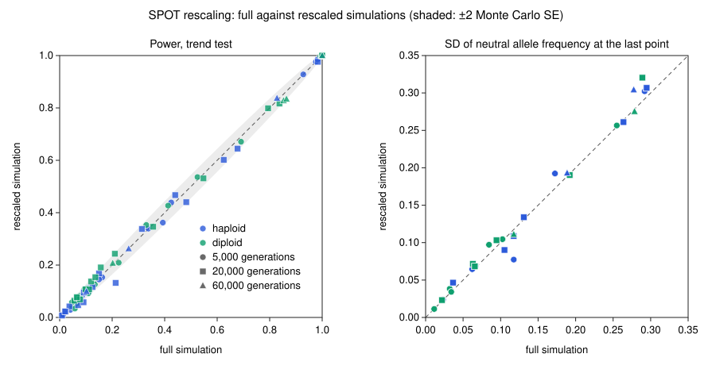

# Validation of rescaling

Summary of the analysis checking that SPOT's rescaling of very long series gives the same power as simulating every generation. Written so it can be adapted for the paper (methods, results and one figure).

## Why rescaling is needed

Historical DNA of organisms with short generations (for example bacteria or viruses sampled over decades to centuries) can span 10⁴–10⁷ generations. Simulating each one is too slow for an interactive page. When the period spans more than 2,000 generations, SPOT simulates each generation as λ real ones, with selection (1+s)^λ − 1, breeding numbers N/λ, migration 1 − (1−m)^λ and sampling times t/λ (see the main README, "Very long series: rescaling"). This is the standard rescaling used by forward simulators such as SLiM: it keeps N·s and the total drift over the period unchanged. It is an approximation, so it has to be checked.

## Methods

- **Designs.** Four sampling points equally spaced over 5,000, 20,000 or 60,000 generations; 20, 20, 20 and 40 individuals; default sequencing settings (10× depth for early points, 15× for the last, 0.5% error). Haploid and diploid; breeding numbers 1,000, 10,000 and 100,000; s = 0.0001, 0.0005 and 0.002; starting frequency 0.01 and 0.1. Only a subset was run at 60,000 generations, to keep the full simulations affordable. In total 80 designs, with λ chosen automatically by SPOT (3, 5, 10 or 30).
- **Comparison.** Each design was run twice: once simulating every generation (full), once rescaled. Each run used 1,000 replicates under selection and 2,000 neutral replicates, with different random seeds for the full and rescaled runs, so the two estimates differ by Monte Carlo noise even if rescaling were exact.
- **Measures.** (1) Power of the trend test with the drift-aware threshold. (2) Standard deviation of the neutral allele frequency at the last sampling point (1,000 neutral trajectories), which measures drift, compared with the theoretical value √(p₀(1−p₀)(1−(1−1/Ne)^G)) for haploids (2Ne for diploids). (3) Run time.
- **Limits.** A separate stress test (`rescale_limits.js`) forced λ from 2 to 200 on four designs to find where rescaling breaks down.

## Results



*Each point is one design. Left: power of the trend test; the dashed line is perfect agreement and the grey band ±2 Monte Carlo standard errors. Right: spread of the neutral allele frequency at the last sampling point (drift); designs that differ only in s share the same neutral runs, so their points overlap. Blue: haploid; green: diploid; symbols: number of generations.*

- **Power agrees within Monte Carlo error.** The mean difference (rescaled − full) was −0.3 percentage points and the mean absolute difference 1.2 points, so there is no systematic bias. Of the 71 designs where power was not exactly 0 or 1, 5 differed by more than 2 standard errors (about 4 expected by chance alone) and 1 by more than 3; the root-mean-square standardised difference was 1.19 (1 expected if the only difference were Monte Carlo noise). The largest difference (8 points) was for a haploid population of 1,000 at the edge of the limits below.
- **Drift is preserved.** The neutral spread from full simulations matched theory (median ratio 1.00), and rescaled runs matched it too (median ratio 1.03). The three designs that differed by more than 15% all started at frequency 0.01, where most neutral replicates lose the allele and the spread is estimated imprecisely.
- **Speed.** Rescaled runs were a median of 4 times faster and up to 29 times faster; the gain grows with the number of generations (for 10⁶ generations a full simulation would be impractical in the browser).
- **Limits.** In the stress test, results stayed within Monte Carlo error while the rescaled selection coefficient was at most about 0.025 and the rescaled breeding numbers at least about 200. Beyond that (for example scaled s ≈ 0.05, or scaled N ≈ 50), power differed by 5–7 points. SPOT therefore caps λ so that scaled s ≤ 0.025 and scaled N ≥ 200. If the caps would leave more than 10,000 generations to simulate, λ is raised anyway to keep the page fast, and the page marks the result as approximate.

## Caveats

- **SPOT against itself.** This shows that rescaling reproduces SPOT's own full simulation. Whether the full simulation is correct is checked separately, against theory ([`theory.md`](theory.md)) and against the independent simulator SLiM ([`slim.md`](slim.md)).
- **Weak selection only.** The tested range (s ≤ 0.002) is the realistic one over thousands of generations. With stronger selection over very long periods the caps are exceeded and the page flags the result as approximate; in those cases the allele usually fixes early and power is close to 0 or 1 anyway.
- **Timing resolution.** With rescaling, the onset of selection and changes in Ne happen in steps of λ generations rather than every generation. This is negligible over thousands of generations.

## Files and how to reproduce

| File | Content |
|---|---|
| `rescale_validation.js` | Runs the 80 designs with full and rescaled simulations and writes `rescale_results.tsv`. |
| `rescale_limits.js` | Forces increasing scaling factors to find where rescaling breaks down; used to set the limits. |
| `make_figure.py` | Draws `rescale_validation.svg` from the results table (Python standard library only). |
| `rescale_results.tsv` | Results of the last validation run (one row per design). |
| `rescale_validation.svg` | The figure above. |

Run from the repository root:

```
node validation/rescale_validation.js > validation/rescale_results.tsv   # about 15 minutes
node validation/rescale_limits.js                                         # about 2 minutes
python3 validation/make_figure.py
```
