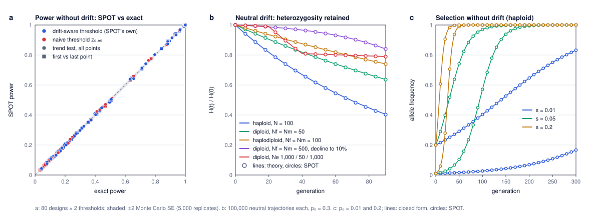

# Agreement with theory

Three checks of SPOT against results that can be computed without simulation. The theoretical values are computed by `theory_check.py`, written from the model equations in the main README and **independently of SPOT's code**; `theory_spot.js` produces the SPOT values.



## a. Power without drift: exact calculation

With no drift and perfect genotypes, the only noise is the sampling of individuals, so power can be computed exactly by enumerating every possible combination of allele counts at the sampling points (up to 5.6 million combinations for four points). The probability of each count follows from the genotype frequencies after selection in the generation sampled.

- **Designs.** 80 designs: haploid; diploid with h = 0, 0.5 and 1; haplodiploid with h = 0.5 (females sampled); p₀ = 0.05 and 0.2; s = 0.005, 0.01, 0.02 and 0.05; four points (1935, 1955, 1975, 2025; 20, 20, 20 and 40 individuals) or two points (1935 and 2025; 20 and 40). SPOT used 5,000 replicates under selection and 10,000 neutral.
- **Comparisons.** 240: the trend test across all points and the first-vs-last test, each with the naive threshold z₀.₉₅ and with SPOT's own drift-aware threshold (the exact power is then evaluated at that same threshold).
- **Result.** SPOT and the exact calculation agree within Monte Carlo error: mean difference 0.00 percentage points, largest difference 1.4 points, root-mean-square standardised difference 0.87 (1 expected from Monte Carlo noise alone), and 5 of 240 differences beyond 2 standard errors (about 11 expected by chance).
- **Note on the threshold without drift.** With no drift and small samples the test statistic takes few distinct values, so no threshold gives exactly 5% false positives: the exact 95% quantile gives 3.2–5.0% (mean 4.5%). SPOT's threshold, an empirical quantile of 10,000 neutral replicates, fell on the same value as the exact quantile in 52 of 120 cases and on a nearby value otherwise (realised sizes 1.75–5.6%), which changed power by up to 6 points. The effect is strongest in this artificial no-drift setting; with drift it is much smaller, except for rare alleles and the two-point test with small haploid samples (see the [false-positive rate analysis](false_positive_rate.md)).

## b. Neutral drift: loss of heterozygosity

Without selection, expected heterozygosity declines as H(t)/H(0) = ∏ (1 − 1/(2Ne)) over generations (∏ (1 − 1/N) for haploids), with Ne = 4NfNm/(Nf + Nm) for diploids and 9NfNm/(4Nm + 2Nf) for haplodiploids. SPOT's mean of p(1 − p) over 100,000 neutral trajectories (p₀ = 0.3, 90 generations) was compared with this formula at every generation.

| Scenario | H(90)/H(0), SPOT | Theory | Standardised difference |
|---|---|---|---|
| haploid, N = 100 | 0.4026 ± 0.0015 | 0.4047 | −1.4 |
| haploid, N = 1,000 | 0.9138 ± 0.0008 | 0.9139 | −0.1 |
| diploid, Nf = Nm = 50 | 0.6361 ± 0.0014 | 0.6369 | −0.6 |
| diploid, Nf = Nm = 500 | 0.9558 ± 0.0006 | 0.9560 | −0.3 |
| diploid, Nf = 100, Nm = 20 | 0.5105 ± 0.0015 | 0.5079 | +1.7 |
| haplodiploid, Nf = Nm = 100 | 0.7397 ± 0.0013 | 0.7404 | −0.6 |
| haplodiploid, Nf = 300, Nm = 50 | 0.7668 ± 0.0012 | 0.7656 | +1.0 |
| diploid, Nf = Nm = 500, decline to 10% | 0.8399 ± 0.0011 | 0.8403 | −0.4 |
| diploid, Ne 1,000 / 50 / 1,000 per interval | 0.7886 ± 0.0012 | 0.7898 | −1.0 |

At every generation the simulated value was within 0.75% of the formula (largest standardised difference at any single generation: 3.5, diploid with Nf = 100 and Nm = 20, where the formula is the long-run rate and the first generations differ slightly). The "neutral heterozygosity lost" tile on the page uses the same formula and reproduces the theoretical values above (to within 0.0001).

## c. Selection without drift

- **Haploid:** SPOT's deterministic trajectories match the closed form p_t = p₀(1 + s)ᵗ / (1 − p₀ + p₀(1 + s)ᵗ).
- **Diploid and haplodiploid:** they match an independent implementation of the recursions in the README (diploid h = 0, 0.5 and 1; haplodiploid h = 0.5 and 0; both sexes).
- Over 36 trajectories of 300 generations (s = 0.01, 0.05 and 0.2; p₀ = 0.01 and 0.2), the largest difference was 2 × 10⁻¹⁵ (floating-point rounding).
- In one diploid case (h = 0.5, s = 0.05, p₀ = 0.01), the mean of 500 stochastic trajectories in a very large population (N = 10⁶) stayed within 0.0006 of the deterministic path.

## Files and how to reproduce

| File | Content |
|---|---|
| `theory_spot.js` | SPOT runs for the three checks; writes `theory_spot.json`. |
| `theory_check.py` | Independent theoretical values, comparison and figure (needs NumPy); writes `theory_power.tsv`, `theory_drift.tsv`, `theory_selection.tsv` and `theory_check.svg`. |

```
node validation/theory_spot.js          # about 30 seconds
python3 validation/theory_check.py      # about 40 seconds
```
